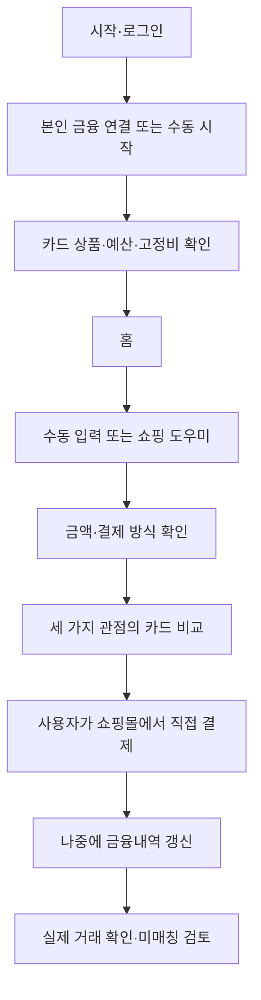

# 02. 사용자 흐름·화면 상세 명세

<mention-page url="https://app.notion.com/p/3fbd86006d0281d9b3d0f2a734dd2d4a?pvs=204"/>
**상태: 구현 전 설계 제안 v1.0.** 수치 목표·기술 선택은 제안값이며 실측 또는 외부 승인 결과가 아니다.
## 전체 흐름

추천을 확인한 사실만으로 결제 완료나 지출 발생을 기록하지 않는다.
## 화면 정의
<table header-row="true">
<tr><td>ID / 화면</td><td>필수 요소·행동</td><td>빈 상태·실패·검증</td></tr>
<tr><td>S01 시작·로그인</td><td>앱 목적, 로그인, 수동 샘플 체험, 개인정보 안내</td><td>동의 거절 시 연결 없이 체험. 샘플 배지 지속 표시. FR-01,19</td></tr>
<tr><td>S02 금융 연결</td><td>기관 선택, 별도 금융 제공 동의, 인증 진행, 성공 기관 목록, 재인증</td><td>기관별 실패 이유와 재시도. 인증수단은 선택한 공식 지원 방식 확정 후 구현. FR-02</td></tr>
<tr><td>S03 카드 확인</td><td>카드 별칭·마스킹 식별, 상품명/발급 시점/버전, 조건 원문, 매핑 후보 확인</td><td>미확정 상품은 조건 기반 추천 제외. 수동 실적은 기준월·시각 필수. FR-03,04</td></tr>
<tr><td>S04 예산·고정비 설정</td><td>월 전체/카테고리 금액, 정기 지출명·예정일·예상액, 저장</td><td>합계 초과 오류. 이미 반영된 고정비는 잔여 예약액에서 제외. FR-05,06</td></tr>
<tr><td>S05 홈</td><td>소비 총액, 전체 남은 예산, 고정비 고려 잔액, 카드별 부족액, 마지막 갱신</td><td>조회 지연·일부 기관 실패 배너. 이번 달 혜택 자격과 다음 달 실적 목표 별도. FR-07,10</td></tr>
<tr><td>S06 쇼핑 도우미</td><td>지원 경로·버전, 감지 ON/OFF, 접근성 고지, 설정 이동, 수동 입력</td><td>거절·철회·미지원 경로를 정상 상태로 처리. 항상 끌 수 있음. FR-11,12,19</td></tr>
<tr><td>S07 결제 정보 확인</td><td>주문 합계, 포인트/머니, 카드 청구 예정액, 카테고리, 결제 방식, 할부, 직접 수정</td><td>읽은 금액 강조. 항목 합이 맞지 않으면 추천 생성 불가. 일부 미확인 시 확인 항목 안내. FR-13</td></tr>
<tr><td>S08 카드 추천</td><td>혜택/실적/균형 탭, 카드별 예상 혜택·실적 변화·즉시 혜택 차이·기준 시각·조건</td><td>상단 예산 초과 안내, 미확인 조건, 추천 보류, 대안 목록. ‘결제’ 버튼 없음. FR-14,15,16</td></tr>
<tr><td>S09 가계부</td><td>기간/카테고리 필터, 승인·취소·환불 연결, 정정, 이체/중복 확인</td><td>원본 금액 수정 불가. 분류·포함 여부만 정정 기록. 미매칭 취소 검토함. FR-07,08,09</td></tr>
<tr><td>S10 소비 분석</td><td>기간 비교, 비교 가능 일수, 카테고리 증감, AI 설명, 예산 변경 제안 미리보기</td><td>자료 부족·AI 실패 시 기본 집계. 자동 예산 변경 없음. FR-17,18</td></tr>
<tr><td>S11 설정·데이터 관리</td><td>동의 상태, 연결 해제, 로그아웃, 계정 삭제, 삭제 작업 상태, 지원 카드·앱 버전</td><td>해제와 과거 거래 삭제의 차이를 설명. 요청 중/일부 실패/완료 분리. FR-21,22</td></tr>
<tr><td>S12 개발자 검수 화면</td><td>규칙 초안·근거·테스트 결과·발행·중지, 샘플 사건 재현</td><td>일반 사용자에게 노출하지 않음. 1차는 보호된 로컬 도구로 대체. FR-20,24</td></tr>
</table>
## 추천 화면의 표시 순서
1. **확인한 결제 금액 50,000원 · 네이버페이 카드 · 일시불**: 수정 버튼과 감지/사용자 확인 배지.
2. 예산: ‘이번 구매 후 전체 70,000원 / 쇼핑 20,000원 / 남은 고정비 고려 40,000원’.
3. 이번 혜택: ‘A카드 예상 1,500원’. 실적 목표: ‘B카드 예상 500원, 270,000 → 320,000원’.
4. 차이: ‘B 선택 시 이번 혜택은 A보다 1,000원 적습니다. 다음 달 혜택은 그달 소비에 따라 달라집니다.’
5. 조건: ‘가상 예시’, ‘실적 인정 대상’, ‘한도·규칙 기준 시각’. 실제 상품 정보가 없는 화면에서는 가상 데이터를 명확히 표시한다.
6. ‘쇼핑몰로 돌아가기’ 또는 닫기만 제공한다. 결제 성공·실제 카드 선택을 추측하지 않는다.
## 상태 및 상호작용
- 계산 중: 금액과 기존 추천을 함께 활성 표시하지 않는다. 이전 카드는 흐리게 두거나 제거한다.
- 금액 변경: ‘주문 내용이 바뀌었습니다. 다시 확인해 주세요’ 후 새 snapshotVersion 생성.
- 화면 이탈/앱 전환/세션 2분 경과: 추천 만료. 2분은 초기 제안값이며 짧은 무효화 이벤트가 우선한다.
- 24시간 초과 금융 스냅샷: ‘갱신 필요’ 배지. 실제 한도 신뢰성이 없으면 단독 최적 카드 단정 금지.
- 오프라인: 수동 입력과 최근 내역 조회는 제공하되 새로운 서버 추천은 미제공. 캐시 결과를 현재 주문의 결과로 재사용하지 않는다.
- 취소 결과: 원거래, 취소액, 잔액, 예산 반영 월, 실적 반영 월을 펼쳐서 보여준다.
## 입력 세부 규칙
금액은 0 이상 정수 원. 주문이 0원이고 카드 승인 예정액이 0원이면 카드 추천 대상 없음. 주문 최대값은 초기 앱 정책 10,000,000원으로 제안하며 서버와 동일하게 제한한다. 월 예산은 최대 100,000,000원으로 제안한다. 선택형 결제 방식은 DIRECT_CARD/NAVER_PAY_CARD/OTHER_WALLET_CARD/MONEY/UNKNOWN. UNKNOWN 상태에서 간편결제 전용 혜택은 단정하지 않는다.
## 화면 공통 접근성
버튼 의미를 텍스트로 제공, 색만으로 확정/추정 구분하지 않음, 큰 글꼴에서 금액·주의 문구 잘림 확인, TalkBack 순서를 읽기 흐름과 일치시킨다. 고지 거절·도우미 종료는 시작만큼 쉽게 제공한다.

