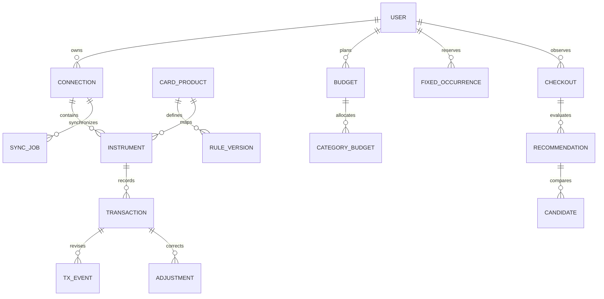

# 05. 데이터 모델·ERD·무결성 명세

<mention-page url="https://app.notion.com/p/3fbd86006d0281d9b3d0f2a734dd2d4a?pvs=204"/>
**상태: 구현 전 설계 제안 v1.0.** 수치 목표·기술 선택은 제안값이며 실측 또는 외부 승인 결과가 아니다.
## 설계 기준
PostgreSQL 단일 데이터베이스를 제안한다. 아래는 논리 스키마로 아직 DB/마이그레이션이 생성된 상태가 아니다. 금액 BIGINT 원, 비율 INTEGER bp, 시각 timestamptz, 월 DATE(해당 월 1일), ID UUID. 사용자 영역의 모든 테이블은 user_id를 포함하며 복합 FK로 다른 사용자의 객체를 연결하지 못하게 한다.
## 관계 개요

## 핵심 테이블과 필드
<table header-row="true">
<tr><td>테이블</td><td>주요 필드</td><td>제약·책임</td></tr>
<tr><td>users</td><td>id, auth_subject, auth_provider, status, timezone, created_at</td><td>(auth_provider,auth_subject) UNIQUE; ACTIVE/DELETING/DELETED</td></tr>
<tr><td>consents</td><td>id,user_id,purpose,version,granted_at,revoked_at</td><td>접근성·금융·AI 목적별 독립 기록. 현재 유효 동의 조회 가능</td></tr>
<tr><td>connection_sessions</td><td>id,user_id,institution,status,expires_at</td><td>본인 인증 challenge 상태, 10분 제안 TTL. 인증 원문 저장 금지</td></tr>
<tr><td>financial_connections</td><td>id,user_id,provider,connected_id_enc,institution,status,last_success_at</td><td>Connected ID 암호화·서버 전용. 사용자+기관 유효 연결 중복 금지</td></tr>
<tr><td>financial_instruments</td><td>id,user_id,connection_id,type,provider_instrument_key_hash,display_mask,product_id,mapping_status</td><td>CARD/ACCOUNT/WALLET; 상품 매핑은 CONFIRMED만 계산 가능</td></tr>
<tr><td>card_products</td><td>id,issuer,name,variant,status</td><td>민감한 카드번호를 상품 카탈로그에 넣지 않음</td></tr>
<tr><td>card_rule_versions</td><td>id,product_id,version,effective_from,effective_to,source_url,source_hash,review_status,rules_json</td><td>제품+버전 UNIQUE, 활성 기간 중복 금지. JSON 스키마 검증</td></tr>
<tr><td>card_state_snapshots</td><td>id,user_id,instrument_id,period,metric,value,source,as_of,rule_version,ledger_revision</td><td>metric=PERFORMANCE/BENEFIT_USED; null은 미확인. 공식·수동·추정 병렬 보존</td></tr>
<tr><td>transactions</td><td>id,user_id,instrument_id,provider_key,approved_at,purchased_at,amount_won,currency,merchant_normalized,status,revision</td><td>금액 비음수. stable provider key가 있으면 사용자+기관+키 UNIQUE</td></tr>
<tr><td>transaction_events</td><td>id,user_id,transaction_id,type,amount_won,occurred_at,provider_event_key,original_ref,match_status</td><td>APPROVAL/SETTLEMENT/CANCEL/REFUND/CORRECTION. 취소는 별도 사건, 재처리 idempotent</td></tr>
<tr><td>transaction_adjustments</td><td>id,user_id,transaction_id,category_id,budget_included,reason,version,updated_at</td><td>공급자 원본과 별개. 사용자 정정 우선, 기존 기록 이력 보존</td></tr>
<tr><td>reconciliation_links</td><td>id,user_id,left_tx_id,right_tx_id,relation,status,confidence_reason</td><td>CARD_BILL/OWN_TRANSFER/REFUND/FIXED_COST; CONFIRMED일 때만 제외·예약 해제</td></tr>
<tr><td>budgets</td><td>id,user_id,month,total_won,version</td><td>사용자+월 UNIQUE, 비음수</td></tr>
<tr><td>budget_categories</td><td>id,budget_id,user_id,category_id,limit_won</td><td>예산+카테고리 UNIQUE, 합계 검증은 트랜잭션 내 실행</td></tr>
<tr><td>fixed_cost_templates</td><td>id,user_id,name,category_id,amount_won,day_of_month,active</td><td>매월 규칙, 말일보다 큰 날짜는 해당 월 말일로 정책화</td></tr>
<tr><td>fixed_cost_occurrences</td><td>id,user_id,template_id,month,due_date,amount_won,status,matched_tx_id</td><td>template+month UNIQUE; PLANNED/MATCHED/SKIPPED. 매칭 취소 시 예약 복구 검토</td></tr>
<tr><td>ledger_projections</td><td>id,user_id,month,category_id,spent_won,ledger_revision,calculated_at</td><td>원장에서 재생성 가능. 정합성 검증 후 단일 revision 교체</td></tr>
<tr><td>checkout_sessions</td><td>id,user_id,client_session_id,source,adapter_version,context_json,snapshot_version,context_hash,expires_at</td><td>사용자+client_session_id UNIQUE. 원문 UI 트리·스크린샷 제외</td></tr>
<tr><td>recommendations</td><td>id,user_id,checkout_id,mode,rule_versions,budget_version,ledger_revision,input_hash,status,expires_at</td><td>불변 결과. VALID/EXPIRED/INVALIDATED/HELD. 계산 버전으로 재현</td></tr>
<tr><td>recommendation_candidates</td><td>id,user_id,recommendation_id,instrument_id,benefit_won,performance_delta,gap_after,reason_codes,uncertainty</td><td>혜택 null 허용. null을 0으로 정렬하지 않음</td></tr>
<tr><td>sync_jobs</td><td>id,user_id,connection_id,idempotency_key,status,range_start,range_end,cursor,error_code,retry_at</td><td>QUEUED/RUNNING/PARTIAL/SUCCEEDED/FAILED/AUTH_REQUIRED, 사용자별 동시성 잠금</td></tr>
<tr><td>ai_suggestions</td><td>id,user_id,target_type,target_id,input_hash,prompt_version,model_version,label,confidence,status</td><td>P1. 원문 금융정보 제외; 사용자 적용 여부와 평가 가능</td></tr>
<tr><td>audit_events</td><td>id,user_id,action,object_type,object_id,result,request_id,occurred_at</td><td>비밀·거래 본문 기록 금지. 운영 감사에 필요한 최소 메타데이터</td></tr>
<tr><td>deletion_jobs</td><td>id,user_id,status,provider_revocation_status,local_purge_status,backup_expiry_at,last_error</td><td>DELETING 이후 신규 연결/수집 차단. 완료 조건 분리</td></tr>
<tr><td>idempotency_records</td><td>user_id,route,key,request_hash,result_ref,expires_at</td><td>동일 키+동일 요청은 같은 결과, 다른 요청은409; 초기24시간 보존 제안</td></tr>
</table>
## 상태·원장 불변조건
- 거래 원장과 카드 규칙은 수정 이력을 보존한다. 취소 합계는 원승인 잔액을 초과할 수 없다. 초과 취소·매칭 실패는 검토함으로 보낸다.
- 공급자 재조회에서 누락된 거래를 자동 삭제하지 않는다. 조회 기간·응답 완전성·취소 근거를 확인한다.
- 카드대금 출금과 원 카드 구매는 서로 다른 객체이며 reconciliation link로 예산 중복을 방지한다.
- 동일 가맹점·금액·시각만으로 UNIQUE를 걸지 않는다. 같은 금액의 반복 구매가 사라질 수 있다.
- 추천 생성은 거래·실적·한도 사용량을 증가시키지 않는다. 승인/매입 내역이 확인되면 다시 계산한다.
- ruleVersion, ledgerRevision, budgetVersion이 모두 같은 일관된 스냅샷으로 읽혀야 한다. 갱신 중 일부 합계만 보이는 상태를 막는다.
## 조회·인덱스
transactions(user_id,purchased_at DESC,id), transaction_events(user_id,transaction_id), sync_jobs(user_id,status,created_at), financial_instruments(user_id,id), recommendations(user_id,checkout_id), card_rule_versions(product_id,effective_from), budgets(user_id,month).
목록 cursor는 (시각,id) 조합으로 페이지 중복/누락을 방지한다. 사용자 영역 전체 조회에도 항상 user_id 필터를 적용한다.
## 보존·삭제 정책 제안
인증 원문·접근성 트리·전체 스크린샷은 영속 보존하지 않는다. checkout 상세/추천은 7일, AI 제안은 30일, 최소 감사 로그는 90일, 금융 내역은 연결 중 최근 12개월 기본으로 제안한다. 실제 보존 기간은 사용 목적·계약·출시 검토 후 확정하며 법정 의무라고 단정하지 않는다.
연결 해제는 새 수집과 외부 연결 철회, 계정 삭제는 로컬 금융 데이터와 파생 데이터 제거를 포함한다. 백업은 제안 7일 순환이며 복구 시 삭제 tombstone을 다시 적용한다.

