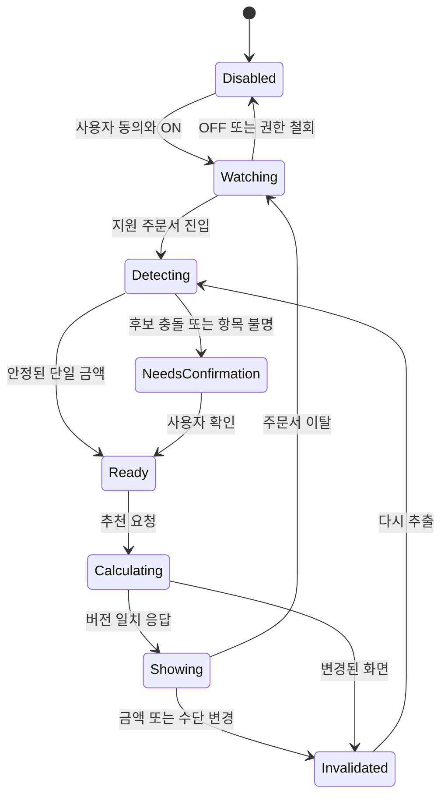

# 08. Android·네이버 쇼핑·무신사 감지 명세

<mention-page url="https://app.notion.com/p/3fbd86006d0281d9b3d0f2a734dd2d4a?pvs=204"/>
**상태: 구현 전 설계 제안 v1.0.** 수치 목표·기술 선택은 제안값이며 실측 또는 외부 승인 결과가 아니다.
## 지원 단위와 순서
사용자가 언급한 네이버 쇼핑·무신사를 대상으로 한다. **네이버 쇼핑 1개 실제 주문 경로를 먼저 검증하고, 무신사를 두 번째로 추가**하는 제안이다. 네이버에서 읽을 수 없으면 순서를 바꾼다.
지원 단위는 ‘브랜드’가 아니라 packageName + appVersion 범위 + 진입 경로 + 주문서 유형 + paymentMethod + adapterVersion이다. 네이버 앱/네이버플러스 스토어/Npay/외부 브라우저 전환은 서로 다른 경로다. 실제 패키지명·뷰 ID는 기기 검사 전 추측해서 넣지 않는다.
네이버 공식 도움말에서 간편결제 매출전표에 카드 가상번호가 표시될 수 있음을 확인했다. 따라서 화면 카드 끝자리만으로 실제 보유 카드와 자동 매핑하지 않는다. [공식 안내](https://help.pay.naver.com/faq/content.help?faqId=11667)
## 접근성 구성 원칙
Android 공식 문서는 AccessibilityService 이벤트·UI 트리 읽기·서비스 선언을 설명한다. 본 앱은 필요한 지원 패키지·이벤트로 범위를 제한하고 제스처/클릭 실행 기능을 사용하지 않는 설계다. UI Automator로 보이는 정보가 실제 서비스에서도 보이는지 별도 확인한다. [Android 공식 문서](https://developer.android.com/guide/topics/ui/accessibility/service)
초기 UI는 앱 내 수동 입력/추천 화면이 기준이다. 실험에서 가능한 경우에만 사용자가 켠 도우미의 소형 접근성 패널을 제공하며 결제 버튼·OTP·로그인 화면을 가리지 않도록 한다. 시스템·앱 제약으로 패널 표시가 불가능하면 앱으로 돌아와 확인한다.
## 어댑터 계약
입력: 허용 앱의 최소 노드 정보와 이벤트 메타데이터(메모리 내). 출력: supportedContextId, isCheckout, amountCandidates, orderValueWon, pointUsedWon, prepaidMoneyUsedWon, cardChargeWon, paymentMethod, installments, splitApproval, evidenceCodes, confidenceTier.
공통 엔진은 앱 이름에 의존하지 않고 어댑터의 정규화 결과만 사용한다. evidenceCodes는 ‘최종결제라벨+인접금액’ 같은 제한된 근거 코드이며 화면 전체 텍스트가 아니다.
## 상태 전이

로그아웃·화면 잠금·서비스 중단은 로컬 스냅샷 삭제와 추천 숨김을 일으킨다.
## 추출과 신뢰도 규칙
1. 지원 package/window가 아니면 즉시 중단. 인증·비밀번호·카드사 결제 확인 화면은 읽지 않는다.
2. 주문서 제목/구조 조건과 최종금액 라벨을 함께 확인한다. 화면에서 가장 큰 숫자를 선택하지 않는다.
3. 금액 후보에서 상품 원가·할인액·배송비·예상 적립액·분할 월납액을 분리한다.
4. 이벤트 마지막 변경 이후 400ms 안정화, 동일 맥락의 2회 일치 관측을 초기 제안값으로 둔다. 두 관측은 동일 값을 두 번 읽었다는 근거일 뿐 의미적 정확성은 별도 검증한다.
5. HIGH: 검증된 경로+명확한 최종 라벨+수단별 합계 일치. MEDIUM: 금액은 읽히나 카드 청구액/수단 일부 불명. LOW: 다중 후보·노드 누락·합계 충돌.
6. P0에서는 HIGH여도 최초 주문 세션에서 사용자 확인 후 추천한다. MEDIUM은 필드 확인, LOW는 수동 입력. 안정성 증거 없이 무확인 추천으로 확장하지 않는다.
7. 금액/수량/쿠폰/포인트/배송비/카드/할부/경로 변경 시 snapshotVersion 증가. 늦게 도착한 서버 응답의 version이 다르면 폐기한다.
8. 다른 앱으로 전환하거나 원래 주문서 복귀 시 다시 읽는다. 수정된 주문액을 이전 추천과 섞지 않는다.
## 네이버 테스트 범위
한 진입 앱·한 주문 유형부터 시작한다. 쿠폰 전/후, 유료/무료배송, Npay 카드, 포인트 혼합, 머니 혼합, 카드 변경, 할부, 여러 판매자/주문, 웹뷰 및 Npay 외부 전환을 각각 기록한다.
여러 상품주문이 존재한다는 사실만으로 카드 승인도 여러 건이라고 확정하지 않는다. 승인 단위를 모르면 splitApproval=UNKNOWN. 해당 경로의 실제 결과는 금융 내역으로 나중에 대조한다.
## 무신사 테스트 범위
Android 앱 주문서에서 일반 결제/사용 가능한 간편결제 경로를 실제 확인한 뒤 지원 경로를 정한다. 회원 등급 할인·쿠폰·적립금·배송비·복수 상품·카드 변경·할부의 최종액 갱신을 점검한다. 제공되는 결제 옵션을 현재 문서만으로 확정하지 않는다.
## 실험 기록 양식
<table header-row="true">
<tr><td>필드</td><td>기록할 내용</td></tr>
<tr><td>contextId</td><td>NAVER-01 또는 MUSINSA-01</td></tr>
<tr><td>환경</td><td>기기 모델, Android 버전, 앱 버전, package, 진입 경로</td></tr>
<tr><td>샘플</td><td>민감정보 제거한 최소 노드 fixture·해시; 전체 화면 원문 공유 금지</td></tr>
<tr><td>상태</td><td>쿠폰/포인트/배송/수단/수량 변화, 화면의 정답 금액</td></tr>
<tr><td>결과</td><td>추출액·카드승인액·confidence·확인 요청 여부·변경 후 지연</td></tr>
<tr><td>판정</td><td>정확/보류/오탐/미탐, 원인, 수정 adapterVersion</td></tr>
</table>
## 통과·실패 처리
경로별 30개 상태 전이 시나리오 제안: 기본/쿠폰/포인트/배송/수량/수단 6종×반복5회. 지원 상태에서 잘못된 금액을 확정 추천으로 사용한 건수0, 금액변경 후 오래된 추천 유지0이 필수다. 보류율·미탐율·p95 지연도 함께 기록한다.
읽을 수 없거나 정책상 불가하면 수동 입력 경로로 범위를 줄인다. P2 스크린샷 공유는 사용자 직접 선택, 기기 내 OCR, 민감 영역 미전송, 금액 확인 후 사용 조건으로 별도 실험한다. OCR 가능성을 이미 구현한 대안으로 기록하지 않는다.

