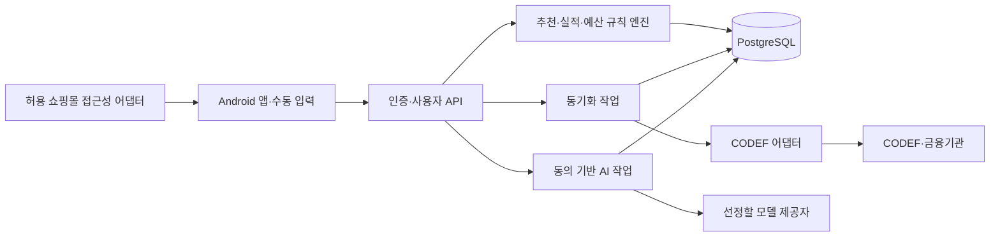

# 09. 시스템 구조·보안·운영 명세

<mention-page url="https://app.notion.com/p/3fbd86006d0281d9b3d0f2a734dd2d4a?pvs=204"/>
**상태: 구현 전 설계 제안 v1.0.** 수치 목표·기술 선택은 제안값이며 실측 또는 외부 승인 결과가 아니다.
## 1인 개발 권장 구조
Kotlin·Jetpack Compose Android 앱 + Spring Boot 모듈형 단일 서버 + PostgreSQL을 기본 제안한다. 개발자가 더 익숙한 백엔드가 있으면 동일 도메인/API 계약을 유지해 바꿀 수 있다. 버전은 착수 시 지원되는 안정 버전으로 잠그며, 아직 최종 스택으로 확정하지 않는다.
추천·예산 계산은 순수 도메인 모듈, 금융 연동은 어댑터, AI는 선택적 비동기 모듈로 둔다. 초기에는 Kafka·마이크로서비스·별도 벡터DB를 도입하지 않는다. 작업 큐는 DB 작업 테이블과 동일 코드베이스의 워커로 시작한다.

추천 요청에서는 CODEF·AI 응답을 기다리지 않는다. 금융 갱신은 별도 작업이며 완료 후 데이터 버전을 갱신한다.
## 모듈 경계
identity, connections, ledger, cards/rules, budgets, checkout/recommendation, insights, operations. 추천 엔진은 사용자 식별정보 없이 규칙·금액·집계 스냅샷으로 작동한다. 도메인 계산은 네트워크 없이 골든 테스트할 수 있게 한다.
## 접근 권한
USER는 자기 데이터만, 개발자 관리 기능은 제품 규칙과 익명화된 운영 메타데이터만 기본 접근. 서버 관리 권한이 있다고 금융 원장을 일반 관리 화면에 노출하지 않는다.
모든 상세조회·수정·비동기 작업·파일·AI 제안에 소유권을 검사한다. 작업 메시지는 서버가 확인한 user_id를 저장하고 실행 시 연결 상태·동의도 재확인한다. 로그아웃/삭제 중 요청과 실행 사이 경합을 테스트한다.
## 데이터 경계와 방어
<table header-row="true">
<tr><td>위험</td><td>구체적 통제</td><td>검증</td></tr>
<tr><td>ID 바꿔 타인 데이터 접근</td><td>토큰의 사용자 필터 + 복합FK + 객체 소유권 검증</td><td>2개 테스트 계정으로 전체 객체 API 교차 호출 거절</td></tr>
<tr><td>Connected ID 노출·오연결</td><td>암호화 저장, 서버에서만 조회, 클라이언트/로그/AI에 반환 금지</td><td>응답·로그·크래시 수집 검사</td></tr>
<tr><td>인증수단 유출</td><td>공식 암호화/전달 방식, 메모리 최소 사용, 요청본문 로깅·분석SDK 수집 금지</td><td>실제 인증 전 합성 값으로 로그 누출 검사</td></tr>
<tr><td>화면 전체 수집</td><td>지원 앱·주문서 최소 노드만, raw tree/배송지/연락처 저장 금지</td><td>수집 payload 키 허용목록 검사</td></tr>
<tr><td>금액 변경·응답 순서 뒤바뀜</td><td>context hash + snapshotVersion + 만료 + 최신 버전만 표시</td><td>변경 중 응답 지연/역순 E2E</td></tr>
<tr><td>AI 입력·출력 오염</td><td>화면/가맹점 문자열을 명령으로 해석하지 않음, JSON 출력 검증, 숫자 대조</td><td>지시문 포함 가맹점·허위 숫자 평가</td></tr>
<tr><td>비밀키 포함 배포</td><td>서버 런타임 비밀 관리, 환경별 분리, APK에 CODEF/AI secret 금지</td><td>저장소·배포 산출물 비밀 검사</td></tr>
<tr><td>동기화 중복·월말 경합</td><td>멱등키·사용자/기관 잠금·revision 원자 교체</td><td>중복/중단 후 재시작·월 경계 테스트</td></tr>
<tr><td>삭제 뒤 재수집</td><td>DELETING에서 작업 접수·실행 차단, 공급자 철회 재시도, 백업 복구 시 tombstone 적용</td><td>삭제 중 실행/재시도/복구 시나리오</td></tr>
</table>
## 고지·동의와 Play
이 서비스는 장애인 지원 도구로 선언하지 않는 기획이다. 접근성 사용은 앱 내 별도 고지에서 읽는 정보·이용 목적·전송 범위를 설명하고 사용자의 명시적 동의를 받는 흐름으로 설계한다. 신고·심사와 실제 승인은 별도 단계다. [Google Play 공식 접근성 정책](https://support.google.com/googleplay/android-developer/answer/10964491?hl=en)
제안 고지 문구: “쇼핑 도우미를 켜면 지원 쇼핑몰 주문서의 결제 금액과 결제 방식을 읽어 카드 비교에 사용합니다. 필요한 금액·수단 정보만 서버로 보내며 배송지·연락처·전체 화면은 저장하지 않습니다. 결제나 카드 선택은 직접 하며, 언제든 도우미를 끌 수 있습니다.”
출시 때 실제 수집·전송 동작과 정확히 대조해 수정한다. 동의를 받은 사실이 이용 정책 승인이나 법적 요건 충족을 자동 보장하지 않는다.
## 보존·삭제 실행
05 문서의 보존 기간은 제품 제안값이다. 만료 작업은 매일 실행하되 삭제 결과와 실패 작업을 기록한다. 금융 해제는 공급자 인증 철회 결과를 확인해야 종료하며, 실패하면 ‘로컬 차단 완료/외부 해제 재시도 중’으로 표시한다.
계정 삭제 시 접근 차단 → 새 작업 차단 → 공급자 해제 → 로컬 원장·추천·AI 제안 삭제 → 백업 만료 기록 순서. 외부 해제 재시도에 필요한 최소 암호화 참조만 제한적으로 보존하고 완료 후 삭제한다.
## 운영·관측
필수 지표: 추천 요청/보류/오류율, 금액 확인 필요율, 오래된 스냅샷 비율, 동기화 지연·기관별 실패·호출량, 규칙별 계산 실패, AI 비용·검증 거절률, 삭제 대기시간.
로그 필드: requestId, jobId, code, durationMs, ruleVersion, adapterVersion. 가맹점 원문·금액·Connected ID·토큰·화면 내용은 기본 로그에서 제외한다. 알림에는 데이터 본문을 넣지 않는다.
제안 알림: 연속 공급자 실패3회, 24시간 넘은 동기화, 삭제 작업24시간 지연, 비정상 추천 실패율5%/15분. 1인 소규모에서는 비율과 실제 건수를 함께 확인해 과도한 경보를 막는다.
## 환경·배포·복구
개발/테스트는 합성 데이터 기본, 본인 실데이터는 분리된 환경에만 사용. 보호된 HTTPS 서버와 DB를 두고 비용 한도가 정해지기 전 유료 자동확장을 켜지 않는다.
릴리스 절차: 도메인 회귀·API 계약·보안 검사 → 테스트 DB 마이그레이션 → APK 실기기 → 서버 배포 → 기능 플래그로 금융/감지/AI 순차 활성. 앱·서버·규칙·어댑터 버전을 한 릴리스 기록에 남긴다.
장애 시 감지나 특정 규칙을 끄고 수동 입력/확인 가능한 데이터만 제공한다. 마이그레이션은 확장 후 전환 방식으로 설계하고 복원 테스트 없는 백업을 복구 가능 증거로 인정하지 않는다. 제안 RPO24시간/RTO4시간은 개인 MVP 목표이며 실측 전이다.

